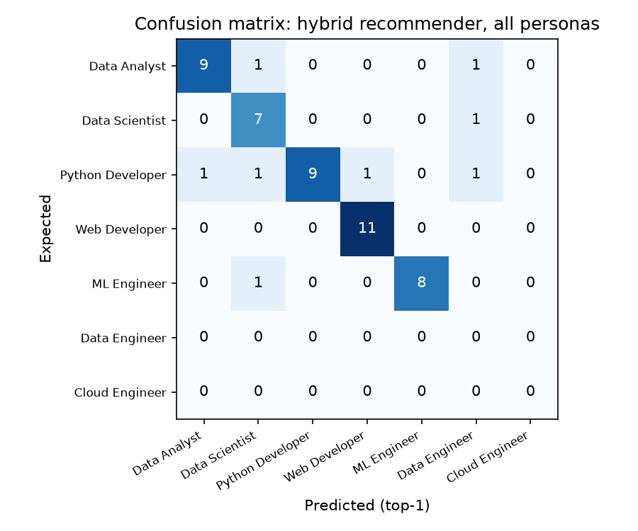
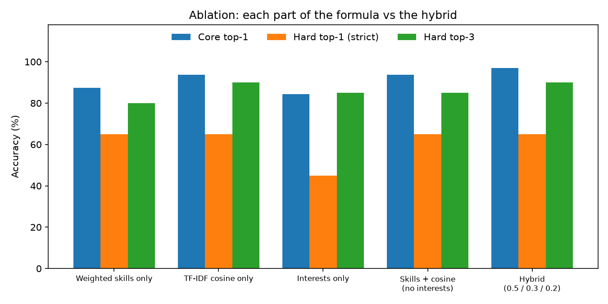

# Recommender evaluation results

Personas: **32 core** + **20 hard** (`evaluation/personas.csv`). Core = typical, clean profiles. Hard = career-changers, single-skill profiles, skills outside the knowledge base, conflicting interests and typos. Labels for both sets were fixed before the results were seen. Generated by `python evaluation/evaluate.py`.

## 1. Ablation

| Configuration | Core top-1 | Hard top-1 strict | Hard top-1 lenient | Hard top-3 | All top-3 | All MRR |
|---|---|---|---|---|---|---|
| Weighted skills only | 87.5% | 65.0% | 90.0% | 80.0% | 92.3% | 0.87 |
| TF-IDF cosine only | 93.8% | 65.0% | 90.0% | 90.0% | 94.2% | 0.89 |
| Interests only | 84.4% | 45.0% | 70.0% | 85.0% | 92.3% | 0.80 |
| Skills + cosine (no interests) | 93.8% | 65.0% | 90.0% | 85.0% | 94.2% | 0.89 |
| Hybrid (0.5 / 0.3 / 0.2) | 96.9% | 65.0% | 90.0% | 90.0% | 96.2% | 0.91 |

Strict = the single expected career. Lenient = expected or a listed acceptable alternative (genuinely ambiguous profiles). MRR = mean reciprocal rank of the expected career.

Hybrid strict top-1, 95% bootstrap interval: hard set 45.0%-85.0% (n=20); all personas 75.0%-94.2% (n=52).

## 2. Weight sensitivity

66 weight combinations (step 0.1). On the hard set strict top-1 ranged 45.0% to 75.0%; the chosen 0.5/0.3/0.2 scores 65.0%, and 2 combinations tie for the best score. Full table: `weight_sweep.csv`.

## 3. Misclassified personas (hybrid, strict)

| Persona | Expected | Predicted | Acceptable? | Top-3 |
|---|---|---|---|---|
| P30 weak signal python only | Python Developer | Data Engineer | no | Data Engineer, Cloud Engineer, Python Developer |
| H01 Java dev with SQL and Excel | Python Developer | Data Analyst | yes | Data Analyst, Data Engineer, Cloud Engineer |
| H04 online-course ML learner | ML Engineer | Data Scientist | yes | Data Scientist, ML Engineer, Data Analyst |
| H05 backend dev with ML basics | Python Developer | Data Scientist | yes | Data Scientist, Python Developer, ML Engineer |
| H09 SQL only, backend interest | Data Analyst | Data Engineer | no | Data Engineer, Data Analyst, Python Developer |
| H12 stats student using R and SPSS | Data Analyst | Data Scientist | yes | Data Scientist, ML Engineer, Data Analyst |
| H14 kitchen-sink profile | Python Developer | Web Developer | yes | Web Developer, Data Scientist, ML Engineer |
| H16 one skill, data-science interests | Data Scientist | Data Engineer | no | Data Engineer, Data Scientist, ML Engineer |

## 4. Supervised baseline (synthetic training data)

| Model | Synthetic test accuracy | Core top-1 | Hard top-1 strict | Hard top-1 lenient | Hard top-3 |
|---|---|---|---|---|---|
| Logistic Regression | 96.1% | 96.9% | 70.0% | 95.0% | 95.0% |
| Random Forest | 94.9% | 96.9% | 60.0% | 85.0% | 90.0% |

The synthetic data comes from the same knowledge base the recommender uses, so the synthetic-test column is optimistic by construction.

## 5. Confidence flag

Profiles with no recognisable technical skills (before this flag existed the app would have shown the first career, at 0-10%, as the best match):

| Profile | Top career returned | Its score | Confidence flag |
|---|---|---|---|
| S1 soft skills only | Data Analyst | 15.6% | none |
| S2 skills outside the knowledge base | Data Analyst | 0.0% | none |

How often the flag fires on the personas (all of them are real-looking profiles, so `none`/`low` here are false alarms, except where a profile really is thin):

| Set | none | low | ok |
|---|---|---|---|
| core | 0 | 1 | 31 |
| hard | 0 | 5 | 15 |

The 20% threshold for `low` is a judgement call chosen after seeing the persona scores; it has not been validated on independent data.

## Limitations

- Personas and the knowledge base were written by the same team; independent labels (classmates, real job postings) would be stronger evidence.
- 52 personas in total is a small sample; treat differences of a few percentage points as noise.
- The sensitivity sweep reuses the same personas, so it shows robustness, not an independent test of the chosen weights.
