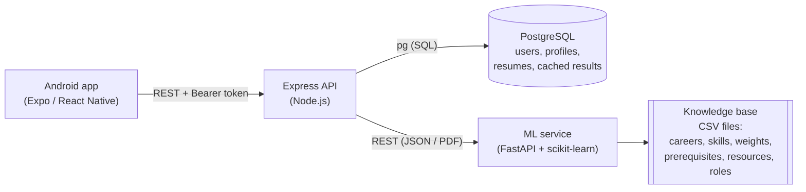
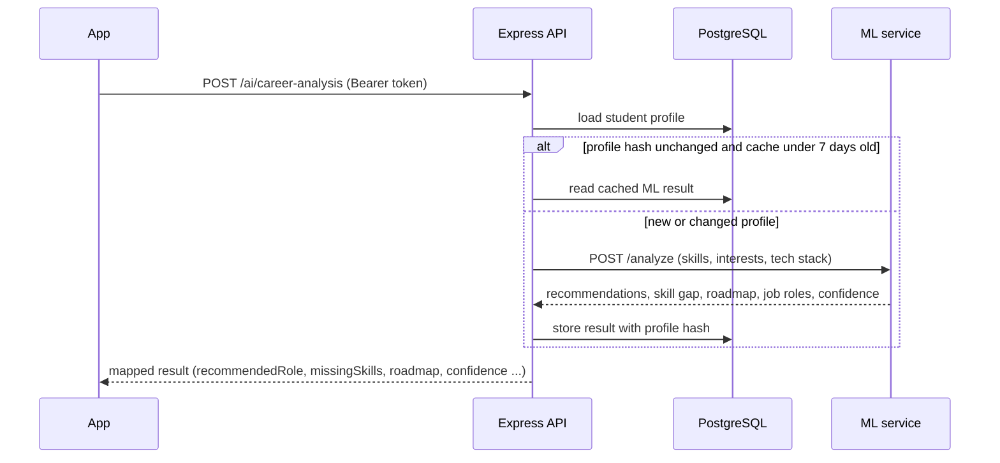
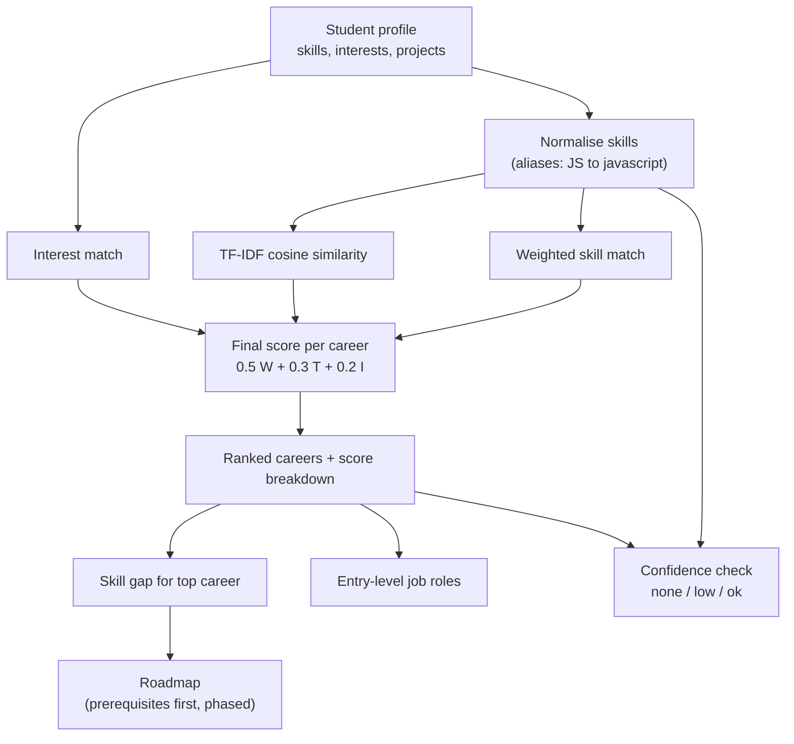

# System architecture

## Components

The ML service is stateless. All user data lives in PostgreSQL, owned by the Express API.

## Career analysis request

## Inside the ML service

Resume analysis is a separate path: PDF, then text extraction (`pdfplumber`), then dictionary skill matching against the same skill vocabulary, then the skills are merged into the profile.

## Where things live

| Part | Folder | Run / test |
|---|---|---|
| Mobile app | `frontend/` | `npx expo start`, `npx tsc --noEmit` |
| API | `backend/` | `npm run dev`, `npm test` |
| ML service | `ai-ml/` | `uvicorn main:app --port 8000`, `python -m pytest -q` |
| Evaluation | `ai-ml/evaluation/` | `python evaluation/evaluate.py` |
