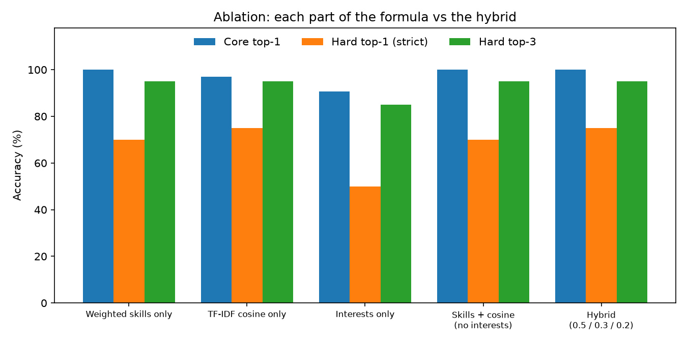
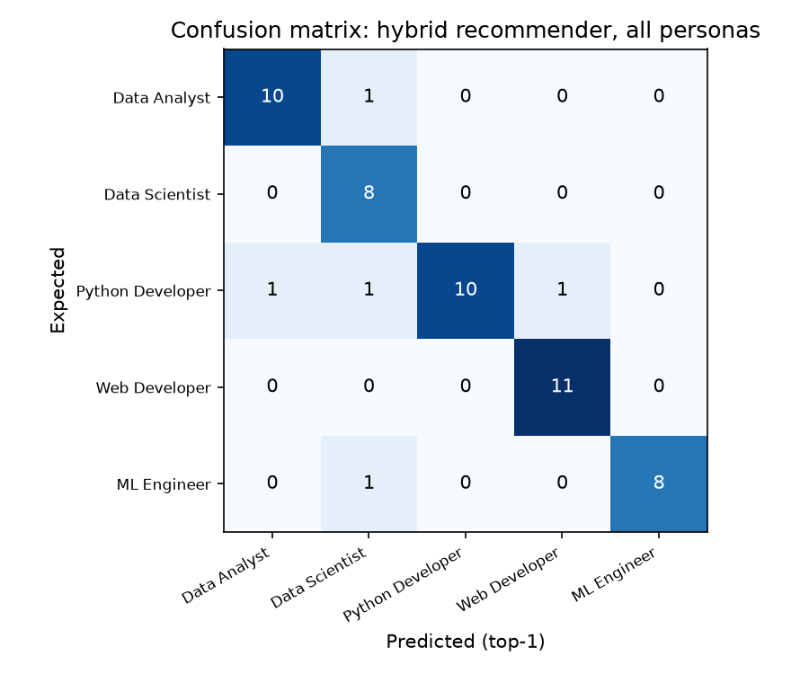

# ML Evaluation Report

How well does the career recommender work, and how much should we trust that claim?
All numbers come from `ai-ml/evaluation/` and can be regenerated with `python evaluation/evaluate.py`
(full tables in `ai-ml/evaluation/results/RESULTS.md`). The numbers below are from the run at the time of writing.

## 1. Method

- **Personas.** A persona is a made-up student profile (skills, interests, experience) with a career we judge to be the right answer.
  - **Core set (32):** typical, clean profiles.
  - **Hard set (20):** career-changers, single-skill profiles, skills the system does not know, interests that conflict with skills, typos, and "kitchen-sink" profiles.
  - Some profiles are genuinely ambiguous (e.g. a data analyst learning ML), so each persona can list **acceptable alternatives**.
- **Metrics.** *Strict top-1* = the system's first choice is exactly the expected career. *Lenient top-1* = first choice is the expected career or an acceptable alternative. *Top-3* = the expected career is among the first three. *MRR* = average of 1/rank of the expected career.
- **Why two sets.** The first run on the core set scored 100% for several different formulas, which means the set was too easy to tell them apart. We then wrote the hard set and **fixed its labels before running it**. The core set was written first and its results were seen, so it is weaker evidence than the hard set.

## 2. Results



| Configuration | Core top-1 | Hard top-1 strict | Hard top-1 lenient | Hard top-3 |
|---|---|---|---|---|
| Weighted skills only | 100% | 70% | 100% | 95% |
| TF-IDF cosine only | 96.9% | 75% | 100% | 95% |
| Interests only | 90.6% | 50% | 80% | 85% |
| Skills + cosine (no interests) | 100% | 70% | 100% | 95% |
| **Hybrid (0.5 / 0.3 / 0.2)** | **100%** | **75%** | **100%** | **95%** |



## 3. What the results do and do not show

1. **Skills carry the signal; interests alone are weak.** Interests-only drops to 50% on the hard set, versus 70-75% for anything that uses skills. This supports using interests only as a supporting signal (20% weight).
2. **We cannot claim the hybrid beats its parts on top-1.** On the hard set the hybrid (75%) ties TF-IDF alone (75%) and is one persona ahead of weighted-skills alone (70%). One persona is 5 percentage points here, and the 95% bootstrap interval for the hybrid's hard-set strict top-1 is 55-90%. The hybrid's small edge in MRR (0.95 vs 0.93 on all personas) is also within noise. The reasons to keep the hybrid are explainability (the weighted part can be read skill by skill) and that TF-IDF down-weights skills common to many careers, not a measured accuracy win.
3. **The chosen weights are reasonable, not optimal.** Across 66 weight combinations the hard-set top-1 ranges from 50% to 80%; the chosen 0.5/0.3/0.2 scores 75% and 7 combinations score 80%. We did **not** change the weights to chase those 5 points: with 20 personas that would be fitting noise.
4. **Mistakes are between neighbouring careers.** All 5 strict misses on the hard set (Java dev with SQL/Excel, online-course ML learner, backend dev with ML basics, R/SPSS statistics student, kitchen-sink profile) are on the acceptable-alternatives list: Data Scientist vs Data Analyst, Data Scientist vs ML Engineer, Python Developer vs Data Scientist. Only the kitchen-sink profile fell out of the top 3, and it has skills from four different careers.
5. **A supervised model did not clearly do better.** Logistic Regression trained on synthetic profiles matched the hybrid on hard strict top-1 (75%) and was one persona better on top-3 (100% vs 95%); Random Forest was worse on top-3 (85%). Their 96-98% accuracy on synthetic test data means little, because the synthetic data is generated from the same knowledge base. A supervised model would also lose the skill-by-skill explanations, so the rule-based hybrid stays the primary engine.

## 4. A defect the evaluation found, and the fix

A student whose skills the system does not recognise (e.g. Kotlin, Swift, Flutter) was shown **"Best match: Data Analyst, 0%"**, simply because Data Analyst is first in the list. A student who typed only soft skills got Data Analyst at 10%, because "communication" is one of its skills. Neither result meant anything, and nothing told the student so.

**Fix.** The ML service now returns a `confidence` flag and the list of skills it did not recognise:
- `none`: no recognised *technical* skills. The app shows an explanation and an "Update my skills" button instead of a match.
- `low`: best score under 20%. The app shows a "limited information" banner above the results.
- `ok`: otherwise.

The flag fired on 5 of the 52 personas (all `low`, none `none`); those are the thinnest profiles (one or two skills), so these are fair warnings rather than false alarms. **The 20% threshold is a judgement call chosen after seeing the persona scores and has not been validated on independent data.**

## 5. Limitations

- **Same authors.** The personas and the knowledge base were written by the same team. Independent labels (classmates, real job postings, a counsellor) would be much stronger evidence. A good next step is to ask 5-10 classmates for their skills and what career they think fits, and run those through the system.
- **Small sample.** 52 personas (20 hard). Differences of a few percentage points are noise.
- **Skills that imply other skills are not modelled.** In the worked example the student knows Power BI but is not credited with "data visualization".
- **No fuzzy matching.** Misspelled skills are not recognised. They are now reported back to the student as "not recognised" rather than silently ignored.
- **Only five careers.** The results say nothing about careers outside the knowledge base.
- **Knowledge base is hand-curated.** Skill weights are our judgement, informed by job postings and roadmaps, not learned from data.

## 6. Reproduce

```
cd ai-ml
python evaluation/evaluate.py        # ablation, sweep, confusion matrix, supervised baseline, confidence stats
python evaluation/worked_example.py  # step-by-step score for one student (see ml-worked-example.md)
python -m pytest -q                  # includes a regression guard on these accuracy numbers
```

## 7. Likely viva questions

- **Is this machine learning?** The core is content-based recommendation using TF-IDF and cosine similarity from Scikit-learn, plus weighted matching. It is not a trained classifier, because there is no labelled dataset of students and careers. We also trained Logistic Regression and Random Forest on synthetic data to compare, and explain why we did not use them.
- **Why not a neural network or an LLM?** No labelled data, no paid APIs, and we wanted every recommendation to be explainable skill by skill.
- **How do you know it works?** On 52 hand-written personas the first choice is acceptable in 100% of cases and the expected career is in the top 3 in 98% (see section 2), but the personas are our own, so the true accuracy is uncertain. See limitations.
- **What does TF-IDF add?** It gives rare, distinctive skills (like TensorFlow) more influence than skills that appear in many careers (like Python).
- **What happens if the student's skills are unknown?** The system says it could not match them instead of guessing (section 4).
